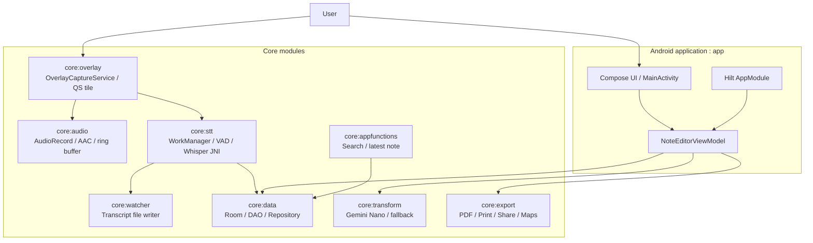

# System Architecture

## 1. System context

Dictator (the application UI currently uses this name) / FieldFlow (the package, service and original SDD naming) is a local-first Android voice-note application. The user can start a recording from a floating overlay or from the in-app editor. The overlay path captures audio to an app-private M4A file and schedules background transcription. The editor path uses Android SpeechRecognizer for live English text while separately capturing audio.

The app stores note metadata in Room and audio/transcript/document files in app-private storage. It can expose a limited note-search interface through Android AppFunctions and export content through Android print/share facilities.

## 2. Container / module diagram

The diagram represents source-level module relationships, not a verified runtime deployment topology.

## 3. Module responsibilities

| Module | Current responsibility | Important implementation boundary |
|---|---|---|
| `app` | MainActivity, Compose editor/onboarding, Hilt setup | UI and user interactions; currently constructs an `EnglishSpeechRecorder` in MainActivity |
| `core:overlay` | `OverlayCaptureService`, overlay touch handling, foreground notification, Quick Settings tile | Owns overlay presentation and starts/stops audio capture |
| `core:audio` | `AudioCaptureController`, ring buffer, AAC encoder/muxer | Captures 16 kHz mono PCM16 and writes M4A into app-private files |
| `core:stt` | `TranscriptionWorker`, VAD invocation, M4A decoding, `WhisperSttEngine` JNI wrapper | Background pipeline; native implementation can currently compile as a stub |
| `core:watcher` | `AtomicTranscriptFileWatcher`, clipboard helper | Writes canonical transcript text and optional MediaStore mirror |
| `core:data` | Room entities/DAO/database and `NoteRepository` | Persists note metadata, segment text, structured documents and FTS index |
| `core:transform` | `DocumentTransformer`, `MlKitGeminiNanoClient`, templates | Uses ML Kit GenAI Prompt API when available; fallback formatter is not equivalent to LLM transformation |
| `core:appfunctions` | `FieldFlowAppFunctionsOps` and generated service entry point | Exposes search and latest-note retrieval; currently returns transcript content |
| `core:export` | `AndroidDocumentExporter` | Uses WebView/PrintManager, PdfDocument, FileProvider and Maps intents |

## 4. Runtime components and ownership

- `OverlayCaptureService` is an Android foreground service declared with `foregroundServiceType="microphone"`. It creates the overlay view and an `AudioCaptureController`.
- `AudioCaptureController` owns an `AudioRecord`, capture coroutine, ring buffer, MediaCodec encoder and MediaMuxer.
- `TranscriptionWorker` is a WorkManager `CoroutineWorker`; it receives recording ID, folder ID, audio path and behavior flags through input Data.
- `FieldFlowDatabase` is a process singleton backed by `fieldflow.db`.
- `NoteRepository` coordinates DAO operations and transcript/Markdown file reads and writes.
- `NoteEditorViewModel` owns editor UI state and orchestrates repository, transform and export calls.
- `BaseFieldFlowAppFunctionService` lazily constructs a database/repository path independently of the Hilt app graph.

## 5. Important architectural observations

### Two capture/transcription paths

The in-app editor creates `EnglishSpeechRecorder`, which uses Android `SpeechRecognizer` with `en-US` and optionally records audio through `AudioCaptureController`. The overlay service uses `AudioCaptureController` directly and enqueues `TranscriptionWorker`. These paths have different transcription providers, timing, persistence and failure behavior. They must not be described as one unified pipeline until the code is unified or a deliberate product contract documents the distinction.

### Native STT boundary

The Kotlin interface is abstracted behind `SttEngine`, but the native CMake build conditionally compiles real whisper.cpp only if the source checkout exists at `core/stt/src/main/cpp/whisper.cpp` (or the configured path). Otherwise, the native library is a stub. Release builds must validate the linked native implementation and supported ABIs.

### Data ownership

The current design uses both Room and files. Room holds metadata and search rows; files hold M4A, TXT and Markdown content. The current implementation does not yet provide a complete transactional/outbox/reconciliation mechanism across these stores. Treat file/database consistency as a known design gap.

### Dependency injection

Hilt is configured in the app module. Some components are manually constructed by Android service/worker entry points. The documentation should not imply that all runtime components are injected from one graph.

## 6. Platform and build baseline

Observed app configuration: minSdk 30, targetSdk 35, compileSdk 35, Java 17. AppFunctions source is annotated for API 36 and manifest declarations use `tools:targetApi="36"`. The Gradle files currently include a machine-specific Android 36.1 platform JAR. This needs resolution before the build can be considered portable.

## 7. Architecture quality attributes

| Attribute | Current design intent | Current limitation |
|---|---|---|
| Offline operation | Local audio capture, VAD and Whisper; Gemini Nano on-device | Whisper source/model are not guaranteed present; SpeechRecognizer is platform-managed and not guaranteed offline |
| Responsiveness | Overlay gestures and background WorkManager processing | No measured latency or responsiveness evidence |
| Reliability | Incremental AAC encoding, WorkManager and app-private files | No durable capture journal or complete crash recovery |
| Privacy | App-private storage; public mirror opt-in parameter | No complete delete/export/restore policy or AppFunctions disclosure policy |
| Extensibility | Multi-module architecture and interfaces | Some modules have direct Android/platform coupling; status contracts are string-based |
| Testability | Unit tests for selected core logic | No evidence of instrumentation/device tests or real native inference tests |

## 8. Architecture constraints

- Audio capture must remain independent of UI lifecycle.
- Long-running work must not run on the main thread.
- Original audio and raw transcript must remain distinct from transformed documents.
- On-device inference is the default design intent; any network/cloud fallback requires explicit opt-in and a separately documented data-flow/security review.
- A release build must not silently substitute a stub for a core promised capability.
